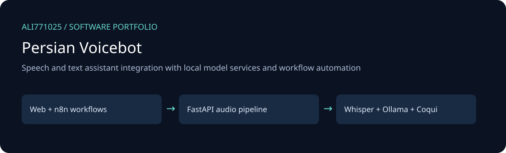
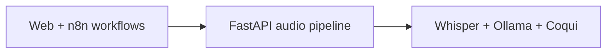

# Persian Voicebot

Speech and text assistant integration with local model services and workflow automation

[راهنمای فارسی](docs/README.fa.md) · [Discuss a project](https://github.com/Ali771025)

## What this project demonstrates

- FastAPI text/audio endpoints and WebSocket voice-session modules.
- Whisper.cpp speech recognition, Coqui speech generation and Ollama integration.
- Importable inactive n8n workflows for text and voice orchestration.

**Technology:** Python, FastAPI, Docker, n8n, Ollama.

## Architecture

The illustration describes source boundaries; it is not a product screenshot.

## Explore and set up

Review `Dockerfile`, `docker-compose.yml`, `requirements.txt` and `app/config.py`. Configure local Whisper.cpp paths and separately obtain compatible speech-model assets; set local TTS and Ollama configuration. The Compose definition is a starting point for local infrastructure, not a model download bundle. Import inactive workflows from `n8n_workflows/` and configure endpoints locally.

## Portfolio scope and limitations

Model weights, media, workflow credentials and n8n state are excluded. The Compose image/model versions are inherited and require review. Speech quality, latency and integration availability have not been newly measured; this publication did not start any service.

This edition contains selected source only. Private data, customer documents, databases, deployment secrets, old Git history, generated outputs, dependency caches and model weights are excluded. No new tests, builds, or live integrations were executed for this publication; runtime behavior and production readiness are not newly validated.

## Work with me

Need a similar workflow, an integration, or modernization of an existing application? [Contact Ali on GitHub](https://github.com/Ali771025) with your business process, target platform and delivery constraints. This source demonstrates relevant implementation areas; any proposed delivery needs its own agreed scope and acceptance criteria.

## Dependencies and attribution

Existing source headers and bundled notices remain applicable. Third-party components retain their own licenses; restore dependencies from the manifests. No additional license grant is implied by this portfolio publication.
